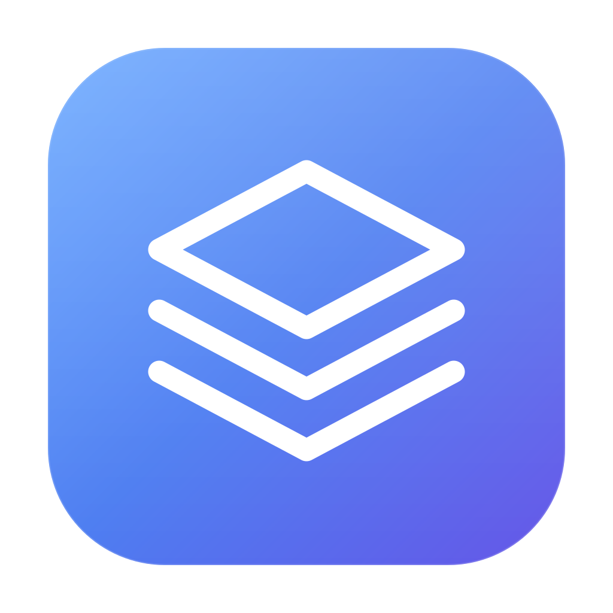

<p align="center">
  
</p>

<h1 align="center">WorkTwill</h1>

<p align="center">
  A local-first workspace for your files and links.<br>
  Organize your work. Leave your files where they are.
</p>

<p align="center">
  English · <a href="README.zh-CN.md">简体中文</a>
</p>

<p align="center">
  <a href="https://worktwill.haoclub.com/">Website</a> ·
  <a href="https://worktwill.haoclub.com/download">Download</a> ·
  <a href="https://worktwill.haoclub.com/guide">User guide</a> ·
  <a href="https://github.com/milesnorthstar/worktwill/issues">Report an issue</a>
</p>

---

WorkTwill brings scattered documents and saved web links into one personal workspace. Find a file, add it to the project you are working on, and open it in its usual app—without moving it into another folder or importing it into a proprietary vault.

A contract can belong to both “Client A” and “Renewals.” There is still only one original file.

> **Preview software.** WorkTwill is under active development for macOS and Windows. Available builds and platform-specific limitations are listed on the [download page](https://worktwill.haoclub.com/download). WorkTwill is open source under the [MIT License](LICENSE).

## Why WorkTwill?

- **Organize by context, not by location.** Group files and links into workspaces. Reference the same resource from multiple workspaces without duplicating the original.
- **Find what you need.** Use quick search or a dedicated search page with type, workspace, modification date, and path or URL filters. Search covers names and locations, not document contents.
- **Keep everyday work close.** Return to recently modified or opened resources, favorite frequently used items, and keep short plain-text notes.
- **See what changed.** Browse a calendar and activity timeline of observed file changes, discoveries, and in-app opens. This is not document version history.
- **Stay in control.** Choose the folders or individual files WorkTwill may access. File search and organization work offline, with no account or AI service required.
- **Use either language.** The desktop interface is available in English and Simplified Chinese.

## Get started

Download an available preview from the [official website](https://worktwill.haoclub.com/download). You do not need Node.js, pnpm, or Rust to use the packaged app.

1. Open WorkTwill and choose a folder to manage, or authorize individual files. Nothing is scanned before you confirm access.
2. Find a resource from the home screen or press **⌘K** on macOS / **Ctrl+K** on Windows to search within the app.
3. Create a workspace for a project, client, or task, and add files or saved links.
4. Open resources in their default applications. Removing a file reference from a workspace does not delete the original.

Current previews do not have OS code signing or macOS notarization. Follow the [installation guide](https://worktwill.haoclub.com/guide), verify the download source and checksum, and respect your device’s security policies. Update-package signatures are separate from OS code signing.

## Your files and privacy

WorkTwill stores its index, workspace relationships, favorites, and notes in a local SQLite database. It does not move, rename, delete, or edit your source files, or place sidecar files in managed folders.

- **Explicit access:** indexing is limited to locations and files you authorize.
- **Local core:** file search and organization do not require a network connection.
- **Optional web titles:** automatic title fetching contacts the destination website and Cloudflare DNS. You can turn it off and enter titles manually. Saved links are URL references, not offline page archives or browser sessions.
- **Networked updates:** update-enabled builds check for new versions and may download them in the background. Automatic downloads can be disabled; installation requires confirmation.
- **App-data backups:** backups preserve application data, not original files. Restoring a backup requires renewed file access authorization.

Read the [privacy notice](https://worktwill.haoclub.com/privacy) for details.

## Current scope

WorkTwill currently focuses on ordinary local folders on internal disks. Network drives, external disks, and cloud-synced folders are outside the V1 support scope.

File identity matters: a new file at the same path is not automatically treated as the original. Renames, moves, and application save behavior depend on the platform and verified file identity. Some editors replace the underlying file when saving; uninterrupted references across every such save operation are **not guaranteed**. If identity cannot be confirmed, explicit relinking may be necessary.

macOS and Windows are validated separately. A successful build or unit test is not proof of full native compatibility. See the [user guide](docs/USER_GUIDE.md) and [installation and update notes](docs/INSTALL_AND_UPDATES.md) for usage and distribution boundaries. Internal acceptance reports are kept outside the public source tree.

## Development

### Requirements

- Node.js 22 LTS and pnpm 10 (the exact pnpm version is declared in `package.json`).
- Rust via rustup; `rust-toolchain.toml` pins the toolchain and components.
- Platform-specific [Tauri 2 prerequisites](https://v2.tauri.app/start/prerequisites/).

```sh
git clone https://github.com/milesnorthstar/worktwill.git
cd worktwill
pnpm install --frozen-lockfile
pnpm desktop
```

For a browser-only UI preview, run `pnpm dev`. Native file access requires the desktop app.

### Checks

The test suite requires an existing, disposable directory that you explicitly approve for generated fixtures. Tests create their own temporary directories inside it. Never use your documents folder or real work files.

```sh
# Replace this path with your approved fixture directory.
pnpm check --fixtures /absolute/path/to/fixture-root
```

This runs DTO drift checks, TypeScript and frontend build checks, UI tests, Rust formatting checks, Rust workspace tests, and Clippy. Native interaction, editor save behavior, installation, and updates need separate platform testing.

Rust DTOs are the source of truth for frontend contracts. After changing `model.rs`, run `pnpm types`; do not edit `desktop/src/contracts.ts` by hand.

For ongoing maintenance, use the [documentation index](docs/README.md), [product contract](docs/PRODUCT.md), and [version/release workflow](docs/RELEASING.md). User-facing changes are recorded in the [changelog](CHANGELOG.md).

### Build locally

```sh
# Local macOS debug app bundle; not a signed or notarized release.
pnpm tauri build --debug --bundles app
```

The macOS output is `target/debug/bundle/macos/WorkTwill.app`. Distribution packaging and update signing are documented in [Installation and updates](docs/INSTALL_AND_UPDATES.md).

### Repository layout

| Path | Purpose |
| --- | --- |
| [`desktop/`](desktop/) | React and TypeScript desktop UI |
| [`src-tauri/`](src-tauri/) | Tauri shell, native integration, permissions, and updates |
| [`crates/worktwill-core/`](crates/worktwill-core/) | Rust domain logic, SQLite storage, indexing, and search |
| [`website/`](website/README.md) | Bilingual website and download pages |
| [`docs/`](docs/README.md) | User documentation, maintenance guides, and documentation policy |

Rust owns authorization, resource identity, workspace relationships, and persisted data. React owns interaction state. The runtime uses Tauri 2, React, TypeScript, Rust, and SQLite.

The root-level `index.html`, `app.js`, `styles.css`, and `prototype-b/` are retained prototypes, not part of the desktop runtime. Experimental tools live in [`spikes/`](spikes/README.md).

## Feedback and contributions

Bug reports, usability feedback, and documentation suggestions are welcome through [GitHub Issues](https://github.com/milesnorthstar/worktwill/issues). Please include your OS, app version, steps to reproduce, and expected versus actual behavior. Remove private filenames, paths, and document contents from screenshots and logs.

For security vulnerabilities, use the private reporting channel in [SECURITY.md](SECURITY.md), not a public issue.

For proposed features or behavior changes, open an issue to discuss the scope first. Read the [contribution guide](CONTRIBUTING.md), [architecture](ARCHITECTURE.md), and [development guidelines](AGENTS.md) before making changes. Use English for commit subjects and bodies, PR titles, and PR descriptions. Public contribution and maintenance do not require internal product plans or acceptance reports. Contributions are provided under the project’s MIT License unless explicitly agreed otherwise.

## License

WorkTwill is licensed under the [MIT License](LICENSE). Copyright (c) 2026 milesnorthstar.

Third-party dependencies retain their own licenses. See [Third-party notices](THIRD_PARTY_NOTICES.md) for the current review scope and distribution requirements.
