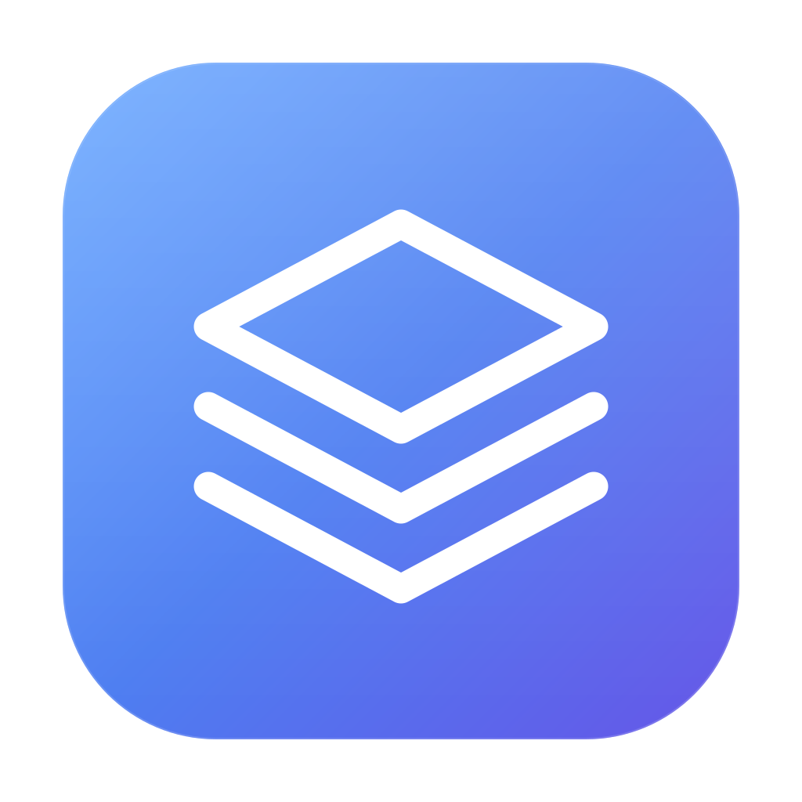

<p align="center">
  
</p>

<h1 align="center">WorkTwill</h1>

<p align="center">
  文件与网页的本地个人工作台。<br>
  围绕工作整理资料，让原文件留在原处。
</p>

<p align="center">
  <a href="README.md">English</a> · 简体中文
</p>

<p align="center">
  <a href="https://worktwill.haoclub.com/">官网</a> ·
  <a href="https://worktwill.haoclub.com/download">下载</a> ·
  <a href="https://worktwill.haoclub.com/guide">使用指南</a> ·
  <a href="https://github.com/milesnorthstar/worktwill/issues">问题反馈</a>
</p>

---

WorkTwill 将散落的文件和收藏的网页组织到一个个人工作台中。找到资料，加入正在处理的工作，再用熟悉的软件打开——无需挪动文件，也不必把它们导入另一个专用资料库。

一份合同可以同时属于「客户 A」和「续约跟进」，而原文件始终只有一份。

> **当前为预览版。** WorkTwill 正在面向 macOS 和 Windows 持续开发。实际可用的安装包及各平台限制以[下载页](https://worktwill.haoclub.com/download)为准。项目以 [MIT 许可证](LICENSE)开源。

## 为什么选择 WorkTwill？

- **按工作组织，不受目录限制。** 用工作区归集文件和网页，同一份资料可以关联多个工作区，无需复制原件。
- **快速找到资料。** 使用快捷搜索或完整搜索页，按类型、工作区、修改日期和路径或网址筛选。搜索覆盖名称与位置，不检索文档正文。
- **常用资料随手可得。** 查看最近修改和最近打开的资料，收藏常用资源，用纯文本便签记录简短事项。
- **回顾工作变化。** 通过日历与动态时间线查看观察到的文件修改、首次发现和应用内打开记录；这不是文档版本历史。
- **由你决定访问范围。** 明确选择可访问的目录或单个文件。文件检索和整理可离线使用，无需账号，也不依赖 AI 服务。
- **中英文界面。** 桌面应用提供简体中文和英文两种界面语言。

## 开始使用

从[官网下载页](https://worktwill.haoclub.com/download)获取可用的预览版。使用安装包不需要安装 Node.js、pnpm 或 Rust。

1. 打开 WorkTwill，选择一个管理目录，或只授权单个文件。确认授权前不会启动扫描。
2. 从首页找到资料，或在应用内按 macOS **⌘K** / Windows **Ctrl+K** 搜索。
3. 为项目、客户或工作事项创建工作区，添加文件和网页链接。
4. 使用系统默认软件打开资料。从工作区移除文件引用不会删除原件。

当前预览版没有系统代码签名或 macOS 公证。请按[安装指南](https://worktwill.haoclub.com/guide)核对下载来源及校验值，并遵守设备的安全策略。更新包验签不等于系统代码签名。

## 文件与隐私

WorkTwill 将索引、工作区关系、收藏和便签保存在本地 SQLite 数据库中，不移动、重命名、删除或编辑源文件，也不在管理目录中写入附属文件。

- **明确授权：** 仅索引你授权的位置和文件。
- **本地核心能力：** 文件检索与整理无需联网。
- **可选网页标题：** 自动获取标题会访问目标网站与 Cloudflare DNS，可关闭并手动输入。网页保存为 URL 引用，不是离线网页存档或浏览器会话。
- **联网更新：** 支持更新的版本会检查新版，并可后台下载安装包。可关闭自动下载，安装前需要确认。
- **应用数据备份：** 备份保存应用数据，不包含原文件；恢复后需要重新授权文件访问。

更多信息见[隐私说明](https://worktwill.haoclub.com/privacy)。

## 当前支持范围

当前聚焦内置磁盘上的普通本地目录。网络盘、外置盘和云同步目录不在 V1 支持范围内。

文件身份与路径并不等价：同一路径上的新文件不会自动被当作原件。改名、移动及编辑器保存后的引用连续性取决于平台和可核实的文件身份。一些编辑器保存时会替换底层文件，**目前不保证所有此类保存都能连续取回**；无法确认身份时可能需要手动重新指向。

macOS 与 Windows 分别验证。构建成功或单元测试通过不代表完整原生兼容性通过。具体结果与待完成事项见 [macOS V1.3.1 记录](docs/V1_3_1_MACOS.md)、[Windows 验收记录](docs/WINDOWS_V1_ACCEPTANCE.md)和[安装与更新说明](docs/INSTALL_AND_UPDATES.md)。工程文档目前以中文为主。

## 本地开发

### 环境要求

- Node.js 22 LTS、pnpm 10；pnpm 的具体版本由 `package.json` 声明。
- 通过 rustup 安装 Rust；工具链及组件由 `rust-toolchain.toml` 固定。
- 对应平台的 [Tauri 2 构建前置环境](https://v2.tauri.app/start/prerequisites/)。

```sh
git clone https://github.com/milesnorthstar/worktwill.git
cd worktwill
pnpm install --frozen-lockfile
pnpm desktop
```

仅预览浏览器界面可运行 `pnpm dev`；原生文件访问需要启动桌面应用。

### 运行检查

测试需要一个已存在、明确允许用于生成测试样本的临时目录。测试会在其中创建各自的临时子目录，不要使用文档目录或真实工作资料。

```sh
# 将路径替换为你已确认的临时测试目录。
pnpm check --fixtures /absolute/path/to/fixture-root
```

该命令执行 DTO 漂移检查、TypeScript 与前端构建、UI 测试、Rust 格式检查、Rust 工作区测试和 Clippy。原生交互、编辑器保存、安装与更新需要按平台单独验证。

Rust DTO 是前端契约的事实源。修改 `model.rs` 后运行 `pnpm types`，不要手动编辑 `desktop/src/contracts.ts`。

### 本地构建

```sh
# macOS 本地调试应用包，不是经过签名或公证的发行版。
pnpm tauri build --debug --bundles app
```

macOS 产物位于 `target/debug/bundle/macos/WorkTwill.app`。发行打包与更新签名见[安装与更新说明](docs/INSTALL_AND_UPDATES.md)。

### 目录结构

| 路径 | 职责 |
| --- | --- |
| [`desktop/`](desktop/) | React 与 TypeScript 桌面界面 |
| [`src-tauri/`](src-tauri/) | Tauri 原生入口、系统集成、权限及更新 |
| [`crates/worktwill-core/`](crates/worktwill-core/) | Rust 领域逻辑、SQLite、索引与搜索 |
| [`website/`](website/README.md) | 双语官网与下载页面 |
| [`docs/`](docs/) | 使用文档、设计决定与验证记录 |

Rust 管理授权、资源身份、工作区关系与持久数据；React 管理交互状态。正式运行时使用 Tauri 2、React、TypeScript、Rust 和 SQLite。

根目录的 `index.html`、`app.js`、`styles.css` 及 `prototype-b/` 为保留原型，不属于桌面正式运行时。实验工具位于 [`spikes/`](spikes/README.md)。

## 反馈与贡献

欢迎通过 [GitHub Issues](https://github.com/milesnorthstar/worktwill/issues)反馈问题、使用体验或文档建议。请提供系统、应用版本、复现步骤、预期与实际行为，并移除截图和日志中的私人文件名、路径及文档内容。

如希望修改代码，请先通过 Issue 讨论范围，并在修改行为前阅读[产品需求](PRD.md)、[技术架构](ARCHITECTURE.md)与[开发约定](AGENTS.md)。这些文档目前以中文为主。除非另有明确约定，贡献采用本项目的 MIT 许可证。

## 许可证

WorkTwill 采用 [MIT 许可证](LICENSE)，版权署名为 Copyright (c) 2026 milesnorthstar。

第三方依赖保留各自的许可证；当前核查范围及发行要求见[第三方许可说明](THIRD_PARTY_NOTICES.md)。
