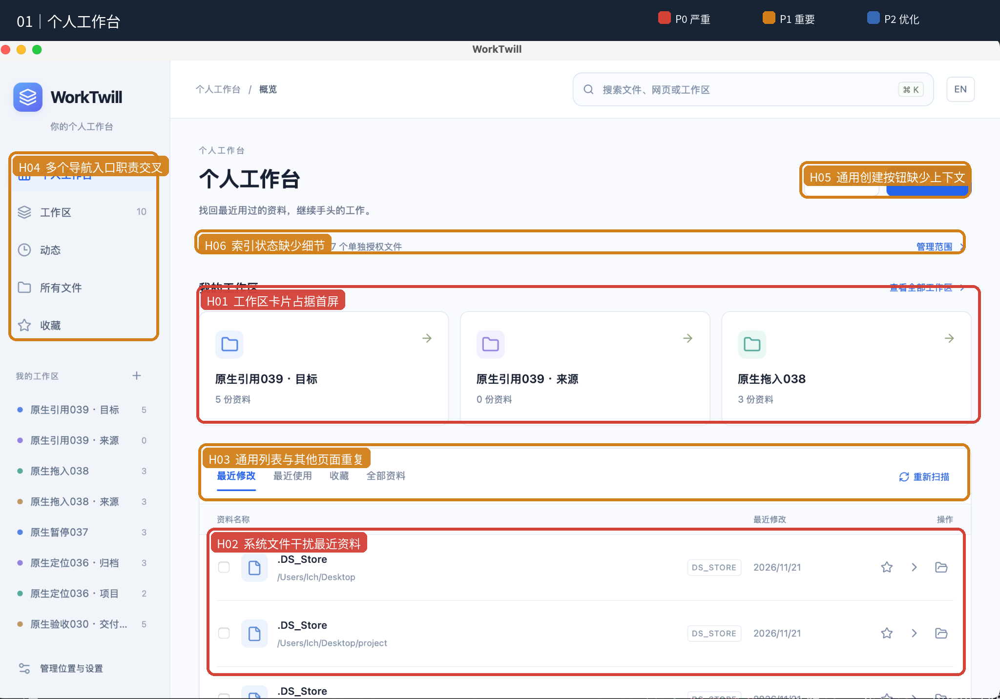
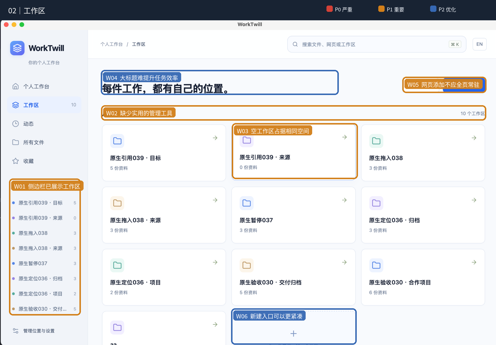
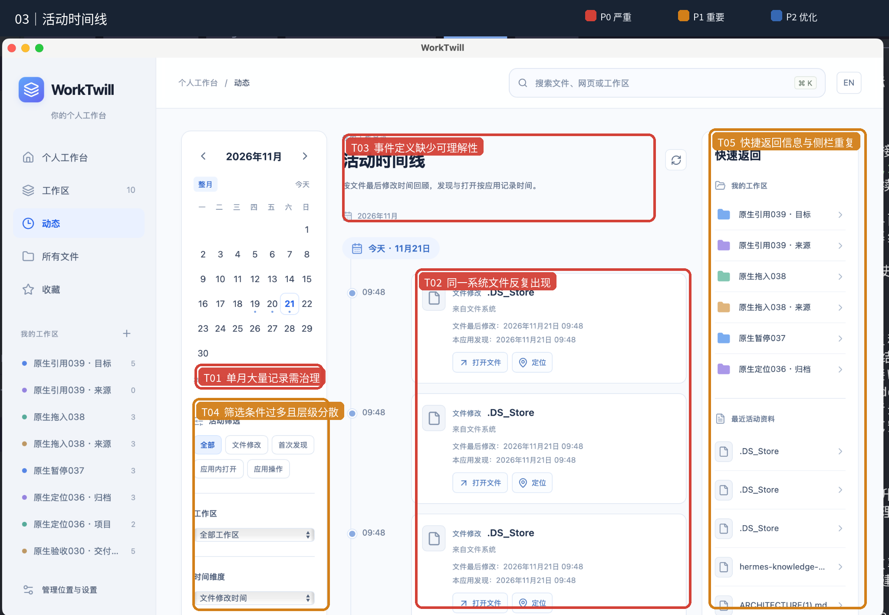
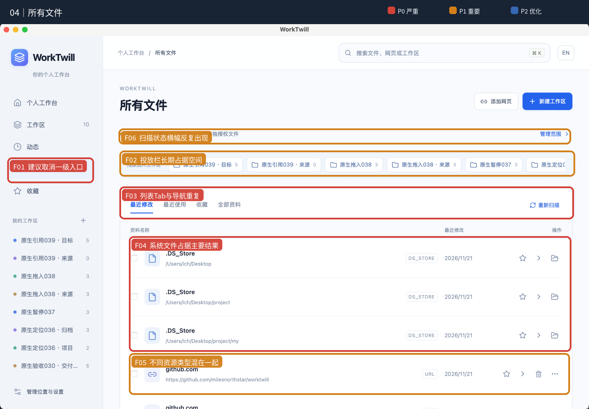
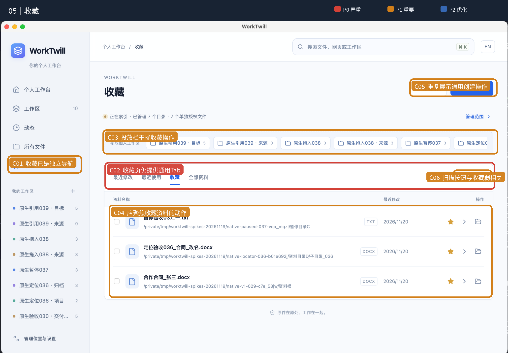
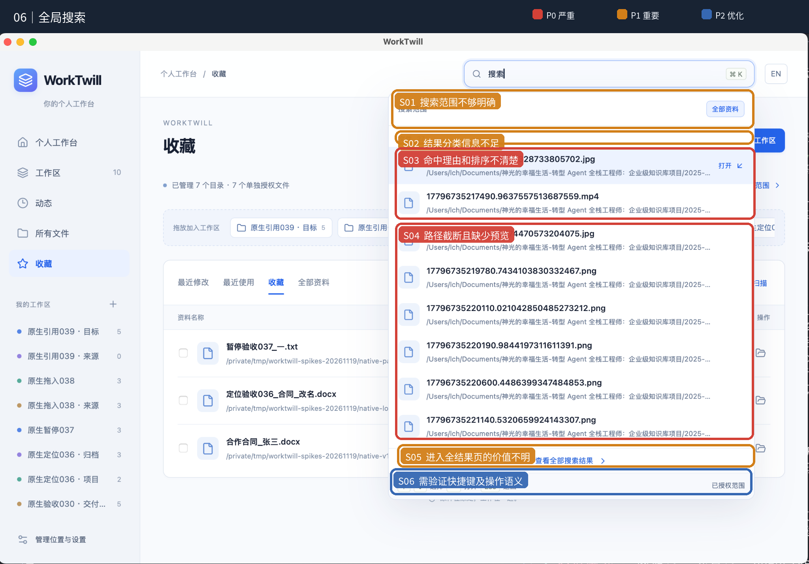

# WorkTwill V1 产品审查与整改方案

> **审查日期**：2026-11-21  
> **审查角色**：资深产品经理 / 桌面生产力工具产品审查  
> **审查范围**：个人工作台、工作区、活动时间线、所有文件、收藏、全局搜索，共 6 个界面  
> **审查依据**：用户提供的 6 张真实产品截图，以及已确认的产品定位：**本地优先、不改变源文件位置、先解决“找得到”和“理得清”，不要求用户先建立工作区**。  
> **证据边界**：这是静态界面审查，不是源码审计或交互实测。涉及真实扫描范围、搜索召回、文件打开监测、数据是否为演示数据等事项，本文会明确列为“需要验证”，不将截图现象直接判定为底层 bug。

## 0. 核心结论与已明确的产品取舍

**总体判断**：当前版本已具备基础产品框架，但“首页、所有文件、收藏”在页面结构和内容上明显重复，工作台首页没有优先承担“继续工作”的任务，时间线和最近资料被系统文件噪声污染。后续不宜继续横向增加模块，应优先简化信息架构、提高资料质量和日常工作效率。

### 0.1 建议立即确定的决策

| 决策 | 建议 | 理由 |
|---|---|---|
| 「所有文件」作为一级导航 | **取消** | 与全局搜索、最近使用、动态、收藏功能重叠；用户并不需要以完整清单的方式逐个浏览大量文件 |
| 「所有文件」作为独立的常驻页面 | **取消** | 不提供独特任务目标，实际成为通用文件列表的另一个容器 |
| 全局文件索引与文件访问能力 | **保留，不得删除** | 全局搜索、时间线、工作区关联都依赖它；删除界面不等于删除能力 |
| 「收藏」作为一级导航 | **当前建议保留，但只做专门的收藏视图** | 收藏有独立的“快速返回高价值资料”任务，但不应在收藏页再次出现全套通用 Tab |
| 「个人工作台」 | **重构首屏信息排序** | 优先“继续工作”，其次“最近动态”和“常用工作区”，而不是先展示工作区卡片 |
| 「工作区」 | **保留，降低初次使用门槛** | 作为资料的虚拟组织关系，而非开始使用 WorkTwill 的前提 |
| 「活动时间线」 | **保留并重点治理事件质量** | 有机会形成明显差异化，但当前重复与系统事件噪声会严重削弱使用价值 |
| 邮箱、协作平台、AI 等新能力 | **不纳入本轮整改** | 当前基础信息架构和文件检索体验尚未稳定，扩大范围会分散投入 |

**对“所有文件夹没有意义”的落实方式**：结合截图与讨论，本文将其具体化为“**删除侧边栏「所有文件」入口与对应的独立业务页面**”；不是删除用户真实磁盘上的文件夹，也不是取消“管理索引范围 / 在 Finder 中定位 / 工作区引用不同目录文件”的能力。

### 0.2 建议的一级导航（本轮）

```text
WorkTwill
├─ 个人工作台       ← 继续工作、最近资料、少量动态与工作区捷径
├─ 工作区           ← 组织与关联资料，支持无工作区先使用
├─ 动态             ← 有价值的全局活动时间线
├─ 收藏             ← 纯收藏清单（可在后续根据实际使用率再决定是否降级）
└─ 管理位置与设置    ← 授权目录 / 单独文件 / 排除规则 / 索引状态

全局固定入口：⌘K / Ctrl+K 搜索
  ├─ 快速结果弹层
  └─ 搜索结果页（仅在确有搜索条件、筛选需求时出现）
```

**不要把“全部资料”作为一个新名字重新放回一级导航**；那只是改名，没有消除重复。确需盘点授权范围内的资料时，在“管理位置与设置”提供管理工具，或由搜索结果页按条件列出。

---

## 1. 跨页面重复问题清单

| 重复内容 | 当前表现 | 不合理的原因 | 调整方式 |
|---|---|---|---|
| 「所有文件」与全局搜索 | 独立“所有文件”页列出索引文件，搜索也能返回文件 | 两套查找入口做同一件事，不符合任务导向 | 删除“所有文件”页；按关键词/过滤条件进入搜索结果页 |
| 「所有文件」与首页“最近修改” | 两处出现相同的文件列表结构与 Tab | 首屏大量空间被重复占用 | 首页只展示少量高价值继续工作项；详细结果跳转到对应检索视图 |
| 「收藏」导航与页内「收藏」Tab | 已进入收藏页，仍需看到“收藏”Tab | 重复表达当前所在位置，造成导航层级混乱 | 收藏页去掉通用 Tab，直接展示已收藏资料 |
| 「最近修改 / 最近使用 / 收藏 / 全部资料」通用 Tab | 首页、所有文件、收藏共用相同 Tab | 实现上的组件复用泄漏到了产品设计 | 各页面只保留自己的核心任务；可复用底层列表组件，不复用不适合的整块交互 |
| 工作区侧边栏与工作区卡片墙 | 同样的工作区出现两次 | 页面未提供足够的新增信息 | 工作区页提供管理、筛选、排序、概要；侧边栏只保留常用/固定工作区 |
| 顶部「添加网页 / 新建工作区」 | 在所有文件、收藏等页面反复出现 | 与当前页面任务关系较弱，抢占视觉位置 | 收敛为全局“添加”或与相关页面绑定的上下文操作 |
| 「拖放加入工作区」栏 | 在所有文件和收藏页反复出现 | 本可由拖拽、右键菜单完成，常驻占用垂直空间 | 改为拖拽时出现的投放区域；平时提供“加入工作区”操作 |
| 「重新扫描」按钮 | 出现在普通浏览和收藏区域 | 扫描属于索引管理，不是收藏内容操作 | 放入索引状态详情/管理位置，必要时使用轻量刷新结果 |
| 活动页右侧“快捷返回”与左侧导航 | 两边提供相似的工作区入口 | 时间线的主体信息被挤窄 | 右侧仅保留与当前选中事件相关的上下文，或默认隐藏 |

> **原则**：共享组件可以复用，但页面任务不能重复。列表渲染代码复用是工程收益；让用户反复看到相同入口，是产品成本。

---

## 2. 逐图审查与标注

**标注规则**：P0 = 当前版本必须修复；P1 = 应在下一轮优化；P2 = 视觉或效率优化。每一处问题均有图片上的独立编号；原始截图也完整保存在 `assets/` 目录中。

### 图 01｜个人工作台



[查看未标注原图](assets/01-home-original.png)

| 编号 | 优先级 | 截图证据与问题 | 原因和风险 | 明确整改建议 |
|---|---|---|---|---|
| H01 | P0 | 首页首屏大面积展示 3 张工作区卡片 | “管理文件组织”凌驾于“继续工作”；用户即使没有工作区也应立即获得价值 | 将首页首个核心区改为“继续工作”，优先展示应用确认打开过的资料、最近修改的真实文档；工作区降为第二层级 |
| H02 | P0 | 最近修改列表连续出现 `.DS_Store` | 系统噪声抢占高价值文件位置，破坏用户对“最近资料”质量的信任 | 默认过滤 `.DS_Store` 等确认无业务价值的系统文件；特殊高级选项才允许包含；同时检查目录扫描、排序和推荐逻辑 |
| H03 | P1 | 首页下方仍显示“最近修改 / 最近使用 / 收藏 / 全部资料”Tab | 这个通用文件表格与其他页面重复，首页只是另一种文件列表外壳 | 首页只显示 5–8 条“继续工作”和少量动态摘要；详情由搜索结果、收藏专页等承接 |
| H04 | P1 | 左侧同时有“所有文件”“收藏”“工作区”等入口 | 加上内容区相同 Tab，用户需反复判断页面和筛选器的区别 | 删除“所有文件”；收藏导航保留但做纯收藏页；其余页面按任务明确边界 |
| H05 | P1 | 右上“添加网页”“新建工作区”在多数页面通用常驻 | 不论用户在查看动态还是收藏，创建操作的优先级都被抬高 | 首页可保留一个更轻量的“添加”入口；工作区页突出“新建工作区”，其他页面不强制展示 |
| H06 | P1 | “正在索引 · 已管理 7 个目录 · 7 个单独授权文件”全宽展示 | 目录数、授权文件数不等于索引文件总数；缺少进度、错误、范围和可操作状态 | 使用精简索引状态入口，可点击查看“扫描中/完成/错误、最近扫描、实际可搜索资料数、排除规则和授权范围” |

**首页调整目标**：用户打开应用后 5 秒内，看见“我刚才做的工作在哪里”和“下一步能做什么”。不依赖创建工作区。

**推荐版式**：

```text
个人工作台
[全局搜索：文件名、路径、网页、工作区]

继续工作                                     查看更多
  最近打开/使用  ·  最近修改  （明确事件来源）
  [文件A] [文件B] [文件C] [文件D] ...

最近动态                      常用工作区
  今天修改的资料                固定或最近访问的工作区
  新发现的资料                  工作区快速进入

收藏捷径（有内容才出现）

索引状态 → 状态指示器 / 管理位置（不占大块首屏）
```

**注意**：上方“最近打开/使用”必须有可靠的行为记录来源。若只能记录用户从 WorkTwill 内打开的文件，就明确标注“从 WorkTwill 打开”，不能冒充整个操作系统的打开历史。

### 图 02｜工作区



[查看未标注原图](assets/02-workspaces-original.png)

| 编号 | 优先级 | 截图证据与问题 | 原因和风险 | 明确整改建议 |
|---|---|---|---|---|
| W01 | P1 | 左侧已列出大量工作区及资料数量 | 右侧还以完整卡片重复列同一批对象，信息增量不足 | 侧边栏默认显示固定/最近访问的少量工作区，提供“更多”；完整管理放在工作区页 |
| W02 | P1 | 右侧“从工作区继续”之后主要是平铺卡片，缺少检索与整理 | 工作区达到几十、上百个后难以定位与维护 | 添加工作区搜索、最近访问排序、名称排序、固定、列表/卡片切换；默认按最近访问而不是创建顺序 |
| W03 | P1 | “原生引用039·来源”显示 0 份资料，却占用完整卡片 | 空卡片与活跃卡片同等权重，降低空间利用率 | 空工作区用明确“添加资料”的空状态；必要时单独折叠“空工作区”分组 |
| W04 | P2 | 页面标题“每件工作，都有自己的位置”占据首屏位置 | 情绪化品牌文案适合官网，不适合高频操作界面 | 改为“工作区”或“我的工作区”，副标题只在首次引导或空状态出现 |
| W05 | P1 | 顶部“添加网页”与“新建工作区”同时高亮 | 用户在管理工作区时，最重要的动作应是管理工作区及其资料 | 保留突出“新建工作区”；“添加网页”移到具体工作区或全局添加菜单 |
| W06 | P2 | 卡片列表底部再出现大面积“新建工作区”卡片 | 与顶部“新建工作区”重复占位 | 只保留一个主入口；无工作区时采用大空状态引导，有工作区时使用紧凑按钮 |

**关键概念确认**：工作区是虚拟资料容器或引用关系，**不是在磁盘中复制、移动或重建文件夹**。在“加入工作区”交互中应有清晰提示；一份资料可出现在多个工作区，源文件仍留原位。

### 图 03｜活动时间线



[查看未标注原图](assets/03-timeline-original.png)

| 编号 | 优先级 | 截图证据与问题 | 原因和风险 | 明确整改建议 |
|---|---|---|---|---|
| T01 | P0 | 日历下方显示“本月 81168 条记录” | 数量很高，但单凭截图不能断言统计有误；若包含无意义事件，将产生严重噪声 | 分析事件来源分布、系统文件比例、重复率；向用户展示“有价值事件”，诊断计数放到索引详情 |
| T02 | P0 | 中间多张连续卡片均为 `.DS_Store` 文件修改 | 单个系统文件连发事件会淹没真正修改过的 Word/Excel/PDF | 系统文件过滤 + 同一资源短窗口内修改聚合，如“10:03–10:08 修改 6 次”；保留可展开的明细 |
| T03 | P0 | 标题描述基于“文件最后修改时间回顾”，单条卡片同时写“文件最后修改”“本应用发现” | 修改时间、首次发现时间和真实用户操作属于不同语义，混写会误导对工作历史的理解 | 显式区分“文件修改”“应用发现”“应用内打开”“工作区关联”等事件类型；无法观测的事件不要推断 |
| T04 | P1 | 左栏同时有日历、活动筛选、工作区、时间维度等多组操作 | 筛选项分散且占据大量垂直空间，主时间线被压窄 | 先提供日期、事件类型、工作区三个主要筛选；高级筛选折叠；保持筛选条件可见并可一键清除 |
| T05 | P1 | 右侧“快速返回”重复展示工作区及最近资料 | 左侧已有工作区导航，右侧又复制一份，造成信息架构重复 | 右栏默认收起；只有选中某条事件时展示“文件详情/关联工作区/同文件历史”；否则给时间线更宽空间 |

**时间线的产品定义**：不是“磁盘监控日志 UI”，而是“帮助用户回忆哪些资料在何时发生过重要变化”。对不能确认的行为（例如用户从外部应用打开了某份文档），不得用文件系统修改时间伪造。

**建议的事件聚合示例**：

```text
今天 11 月 21 日
09:48  合作合同_张三.docx 已修改
09:20  产品需求稿.pdf 首次纳入索引
昨天 11 月 20 日
18:42  项目进度.xlsx 在 WorkTwill 中打开
16:10  工作区「原生引用039·目标」新增 3 份资料
```

> 示例内容仅说明事件形式，不是对截图中真实文件行为的推断。

### 图 04｜所有文件：建议删除的页面



[查看未标注原图](assets/04-all-files-original.png)

| 编号 | 优先级 | 截图证据与问题 | 原因和风险 | 明确整改建议 |
|---|---|---|---|---|
| F01 | P0 | 侧边栏存在“所有文件”独立一级导航 | 未形成区别于全局搜索、最近使用和工作区的明确任务 | **删除该导航入口；移除常驻的“所有文件”业务页面** |
| F02 | P1 | “拖放加入工作区”横向区域常驻顶部 | 以功能证明功能的存在，挤占真正结果空间 | 改为用户开始拖拽资料时显现投放目标；非拖拽场景在行菜单提供“加入工作区” |
| F03 | P0 | 与首页、收藏复用“最近修改、最近使用、收藏、全部资料”Tab | 用户无法分辨独立页面的任务差异，重复导航 | 不再提供“万能文件列表”作为多个一级页面共享的主体；搜索结果页只用真正的结果筛选器 |
| F04 | P0 | 最前面的多条资料均为 `.DS_Store` | 列表可用性低，优先级排序不匹配办公需求 | 默认过滤无意义系统文件，重建默认推荐/列表排序，提供受控的高级“显示系统文件”选项 |
| F05 | P1 | 同一列表既出现本地文件，也出现 `github.com` 网页 | 资源模型可以统一，但同一“文件”标签与相同操作会造成类型混淆 | 底层统一为“资料”，UI 显示文件/网页独立图标、来源、打开行为及过滤条件 |
| F06 | P1 | “正在索引”状态几乎占满一条跨页面横幅 | 扫描属于全局基础能力，不应在普通资料浏览场景反复打断 | 移到全局状态入口或“管理位置与设置”，状态异常时才做显著提示 |

#### 删除“所有文件”后，能力如何承接？

| 以前可能在“所有文件”做的事情 | 新入口 | 是否保留 |
|---|---|---|
| 按文件名找资料 | ⌘K / Ctrl+K 搜索 | 保留 |
| 查看命中资料的完整列表 | 搜索结果页 | 保留 |
| 按文件类型、目录、时间查找 | 搜索结果页筛选 | 保留 |
| 打开文件 / 在 Finder 或资源管理器定位 | 每个搜索结果、最近项目、工作区项目中的操作 | 保留 |
| 将文件加入多个工作区 | 结果列表快捷操作、详情面板、拖拽 | 保留 |
| 设置哪些目录/文件可被索引 | 管理位置与设置 | 保留 |
| 检查索引统计、失败文件与排除项 | 管理位置与设置 | 保留 |
| 无条件浏览海量文件总表 | 不作为主路径提供；仅在必要的高级管理/搜索场景按条件呈现 | 不作为独立页面保留 |

**实现提醒**：删除页面时处理旧路由、书签和导航状态。不要通过把“所有文件”改叫“全部资料”或“资源库”规避这一决策。

### 图 05｜收藏



[查看未标注原图](assets/05-favorites-original.png)

| 编号 | 优先级 | 截图证据与问题 | 原因和风险 | 明确整改建议 |
|---|---|---|---|---|
| C01 | P1 | 收藏已作为一个独立一级导航 | 本身不是错误，问题在于页面内部仍共享其他页面的通用操作结构 | 暂保留收藏入口，但明确其唯一任务是“快速回到标记的重要资料” |
| C02 | P0 | 收藏页上方依然提供“最近修改 / 最近使用 / 收藏 / 全部资料”Tab | “已经进入收藏，再选择收藏”属于直接重复 | 取消这一组 Tab，进入页面即显示收藏资料；必要时提供文件类型、工作区和排序筛选 |
| C03 | P1 | 收藏顶部再次出现工作区拖放条 | 收藏操作与工作区管理混在一起 | 将“加入工作区”放在行操作/批量操作中；拖拽时临时显示目标 |
| C04 | P1 | 收藏主体继续沿用通用资料行，主要是文件名、路径和图标 | 没有让收藏比普通搜索结果更容易取回或管理 | 展示收藏时间、最近打开时间（若已可靠记录）、所属工作区；突出打开、取消收藏、加入工作区 |
| C05 | P1 | 收藏页仍然常驻“添加网页 / 新建工作区” | 与收藏这一独立任务无关 | 移至更适合的上下文，收藏页顶部只保留与收藏内容相关的动作 |
| C06 | P1 | “重新扫描”出现在收藏列表上方 | 索引管理入口与收藏资料管理混淆 | 移到索引状态详情；收藏列表只需轻量刷新/自动响应数据变化 |

**待验证的后续决策**：若真实使用发现收藏入口使用率很低，可将收藏降级为首页快捷区 + 搜索筛选；本轮先不贸然删除一个可能高频的返回入口。

**证据注意**：截图里收藏路径位于 `/private/tmp/...`，可能是自动化测试数据，不应直接据此判定生产数据持久化方案错误。需要另外验证临时文件消失后的收藏状态和失效提示。

### 图 06｜全局搜索



[查看未标注原图](assets/06-search-original.png)

| 编号 | 优先级 | 截图证据与问题 | 原因和风险 | 明确整改建议 |
|---|---|---|---|---|
| S01 | P1 | 搜索顶部仅看到“搜索范围 / 全部资料” | 用户不清楚包含文件名、路径、网页标题、工作区名称还是内容全文 | 明示支持的范围；提供本地文件、网页、工作区的可选类型过滤，未实现的全文搜索不得暗示已支持 |
| S02 | P1 | 结果分组写作“文件 27” | 截图只显示文件分组；是否支持网页/工作区命中无法从截图确认 | 分组展示“文件 / 网页 / 工作区”（仅在实际有对应结果和能力时出现）；显示数量与查询条件 |
| S03 | P0 | 输入“搜索”后展示若干数字命名 JPG/MP4，未显示关键词命中的位置 | 可能匹配文件路径或其他字段，不能据此认定搜索错误；但结果相关性完全不可解释 | 对每项标明“文件名匹配 / 路径匹配 / 网页标题匹配 / 内容匹配”，高亮实际命中词；相关性排序可验证 |
| S04 | P0 | 文件名长、路径截断，文件种类图标大体相同 | 难以快速判断哪个是目标文件，也缺少“检查后再打开”的途径 | 显示资源类型图标、完整路径的悬停/详情、修改时间、可用预览；对图片可考虑缩略图（性能允许时） |
| S05 | P1 | 弹层底部有“查看全部搜索结果” | 若“全部结果”只是重复“所有文件”，仍然会制造新重复页面 | 仅在弹层展示数量有限、需要过滤或查看更多时进入独立搜索结果页，并保留关键词、排序与筛选上下文 |
| S06 | P2 | 底部提供方向键/回车/Esc 等快捷键说明 | 这是有价值的键盘优先设计，但截图无法确认所有交互是否一致 | 用自动化测试验证上下选择、打开行为、Esc 关闭、焦点恢复和滚动定位；为鼠标用户保留清晰操作 |

**全局搜索应承担“找得到”的核心任务**。建议先把已支持的文件名、路径、网页标题与工作区名称检索做到可靠、可解释，再按技术可行性引入正文索引/预览。避免在能力尚未实现前对用户承诺“搜索任意内容”。

---

## 3. 三个必须优先修复的系统性问题

### 3.1 资料去噪与索引可见性（P0）

**当前证据**：首页、所有文件和时间线均出现 `.DS_Store`。这不必然说明索引引擎错误，但说明“默认面向用户的结果集”没有做好办公价值过滤。

**整改原则**：

1. 建立一个统一的“用户可见资料过滤层”，而不是首页、搜索、时间线各自处理一遍。
2. 默认排除确认无业务价值的系统工件，例如 macOS `.DS_Store`、Windows `Thumbs.db`、Office 临时锁文件（如 `~$` 前缀）等。实际规则应按平台、目录来源和文件类型验证。
3. **不要粗暴排除所有隐藏文件、所有点号开头文件、所有临时目录**。这会误伤开发者有用的 `.env`、配置文件、受控业务文件或测试资料。
4. 用户明确授权的文件仍应能通过高级设置查看/纳入；底层如何保存索引与“默认展示什么”分离。
5. 文件失效、授权撤销、路径移动时，搜索、收藏和工作区应呈现一致的失效状态，不应静默显示打不开的条目。

**验收**：默认首页、默认搜索结果、默认时间线均不出现上述系统工件；在高级模式启用后可被检索；不会误删源文件，也不会擅自移动文件。

### 3.2 活动事件语义与去重（P0）

建议先明确事件模型：

| 事件 | 触发依据 | 可对用户使用的文案 | 禁止的推断 |
|---|---|---|---|
| 文件修改 | 操作系统/文件监控或元数据确认的修改 | “文件修改”或“检测到文件修改” | 不等于用户真的打开过文档 |
| 首次发现 | 首次进入本应用索引时 | “首次纳入索引” | 不等于用户刚创建文件 |
| 应用内打开 | 用户从 WorkTwill 触发打开且记录成功 | “从 WorkTwill 打开” | 不等于用户从 Finder/其他应用打开过 |
| 工作区关联 | 用户将资料加入/移出工作区 | “已加入工作区” | 不等于移动真实文件 |

对同一资源同类事件的短时间高频变化，可设置**产品级聚合**（例如 5 分钟窗口，具体数值需结合实际办公行为验证）；原始事件可供内部诊断或展开查看。不要因为合并呈现而丢失审计需要的事件记录（如确有审计要求）。

**验收**：同一文件短时间 20 次连续修改不应默认占满 20 张大卡片；时间线事件类型与来源一致；首次发现不会被冒充为实际编辑或创建。

### 3.3 搜索结果可信度（P0）

需要分离三个层次：

- **召回**：应该找到的授权资源能够被找到；支持哪些字段必须公开说明。
- **相关性**：文件名强匹配通常优先于弱路径匹配，支持按最近使用/修改辅助排序；具体策略需测试，不要未经数据验证随意调权重。
- **可判断性**：结果显示命中位置、文件类型、路径、时间、所属工作区；用户可以预览/定位，再决定打开。

**验收**：使用一组含同名文件、数字文件名、多层目录和网页书签的真实样例数据，用户能够在结果中判断“为什么找到它”“是不是我要的”“打开后在哪里”。

---

## 4. 页面职责和交互标准（整改后的目标）

| 页面 | 只承担的主要任务 | 关键内容 | 不再出现的内容 |
|---|---|---|---|
| 个人工作台 | **继续工作** | 最近在本应用打开、最近修改、少量动态、常用工作区与收藏捷径 | 完整工作区卡片墙、通用“全部资料”表格和 4 个重复 Tab |
| 工作区 | **理清组织关系** | 工作区查找、排序、固定、进入详情、管理资料引用 | 与侧边栏等量重复且不含管理信息的卡片堆叠 |
| 动态 | **按时间回溯有意义的变化** | 事件类型、日期筛选、聚合时间轴、事件关联资料 | `.DS_Store` 噪声、重复的右侧工作区总清单 |
| 收藏 | **快速返回重要资料** | 资料列表、排序、工作区归属、取消收藏、打开/定位 | “最近修改 / 最近使用 / 收藏 / 全部资料”Tab 和常驻扫描入口 |
| 搜索弹层 | **秒级定位** | 少量高相关结果、命中依据、键盘操作 | 无上限的长列表、结果与路径匹配依据不明 |
| 搜索结果页 | **精确筛选与批量处理** | 关键词、文件类型、日期、路径、工作区等筛选及列表操作 | 无条件全量文件浏览首页 |
| 管理位置与设置 | **管理授权和索引健康** | 目录/文件授权、排除项、统计、错误、重扫 | 不属于业务列表的全局扫描控制散落在每个页面 |

### 4.1 资源模型建议（非本轮新增功能）

底层使用“资料（Resource）”作为统一逻辑概念，各具体类型保持清晰区别：

```text
Resource
├─ LocalFile   → 本地路径 / 可用性 / 文件元信息
└─ WebLink     → URL / 页面标题 / 来源 / 可用性（按已支持范围）

WorkspaceResource  → 工作区与资源的多对多关联
Favorite           → 收藏状态
Activity           → 与资源/工作区相关联的可解释事件
```

这只是信息模型建议，不要求立即进行高成本的数据表重构。重点是 UI 和业务语义保持一致：**同一份实际资料可以被多个工作区引用，收藏只是附加状态，活动属于时间事件，不应重复生成一份文件实体。**

### 4.2 交互规范建议

- 搜索始终可由 `⌘K`（macOS）/ `Ctrl+K`（Windows）唤起，不依赖当前页面。
- 搜索弹层显示有限条目；按 Enter 后的进入方式、选择结果的行为必须一致，区分“打开结果”和“查看更多”。
- 工作区资料行支持“打开、定位源文件、收藏、加入/移出工作区”；不通过复制文件实现“加入”。
- 拖拽时再显示工作区投放目标；同时提供无拖拽的等价操作，兼顾触控板、键盘与无障碍场景。
- 所有页面应准确区分“修改时间”“索引发现时间”“应用记录的打开时间”，不混用字段。
- 删除一级导航时同步检查多语言文案、侧边栏激活状态、深层链接、空状态、快捷键和自动化测试。

---

## 5. 研发实施顺序

### 第一阶段：P0，清除结构重复和无效信息

**建议作为一个独立可验收的迭代。**

1. 移除“所有文件”一级导航及独立页面；保留索引、搜索和源文件定位能力。
2. 收藏页移除通用 Tab、顶部拖放条及不相关操作，改为专门的收藏视图。
3. 首页移除通用文件 Tab 和完整卡片优先展示方式，创建“继续工作”主区。
4. 统一过滤系统文件噪声，修复首页/搜索/时间线的默认可见结果。
5. 规范时间线事件文案、事件来源和短窗口聚合策略。
6. 搜索结果至少补充文件类型、命中字段、必要元数据和完整路径查看方式。

**退出条件**：不再存在“所有文件”一级页面；首页、收藏、工作区、动态各有清晰且不重复的主要任务；系统文件不再主导默认结果。

### 第二阶段：P1，提高高频工作效率

1. 工作区页面添加排序、固定、搜索、空工作区处理。
2. 活动页面精简筛选器，右侧重复导航改为上下文详情或收起。
3. 全局索引状态移入状态入口/设置，补充扫描详情、错误解释、排除规则。
4. 搜索结果页做类型/时间/位置筛选，并对当前搜索上下文保持状态。
5. 收藏增加收藏时间、资料状态与明确的快速操作。
6. 简化全局“添加网页 / 新建工作区”按钮的位置和上下文。

### 第三阶段：P2，设计精修与习惯养成

1. 统一图标语义：文件类型、网页、工作区、时间事件、失效资源。
2. 降低大面积空白与重复标题文案，提高列表适度密度与信息可扫描性。
3. 加强悬停、焦点、键盘操作、批量操作和拖拽状态反馈。
4. 依据真实用户使用情况，决定“收藏”是否继续维持一级导航。
5. 最后再进行整体的视觉高级感优化，避免在不合理的信息架构上反复换皮肤。

---

## 6. 必须执行的验收场景

以下可直接转化为 Playwright/E2E 或桌面端集成验收用例（涉及系统级文件监控与打开行为时，需配合原生端测试，而非仅用浏览器模拟）。

| ID | 场景 | 通过标准 |
|---|---|---|
| A01 | 新用户只授权文件目录，不创建任何工作区 | 首页可展示真实最近资料，搜索可用，时间线有可解释信息 |
| A02 | 左侧导航浏览 | 不存在“所有文件”一级入口；没有以别名重新出现的同类独立页面 |
| A03 | 进入收藏页 | 不出现“最近修改/最近使用/收藏/全部资料”重复 Tab；默认只展示收藏资料 |
| A04 | 工作区添加同一个文件到 A、B | 两个工作区都能访问同一资源，真实源文件未移动或复制 |
| A05 | 扫描含 `.DS_Store`、`Thumbs.db`、`~$合同.docx` 目录 | 这些系统工件不出现在默认最近资料与普通动态中 |
| A06 | 扫描含 `.env` 等有意义隐藏文件的目录 | 不因“隐藏文件”一概被过滤，行为符合明确的授权/过滤策略 |
| A07 | 同文件 5 分钟连续修改多次 | 默认时间线聚合或摘要呈现，用户仍可根据设计查看必要明细 |
| A08 | 新授权一个历史目录 | “首次发现”不被标记为“今天创建”或“今天编辑” |
| A09 | 从 WorkTwill 打开文件 | 若有日志能力，时间线/最近使用明确标记为“从 WorkTwill 打开” |
| A10 | 通过 Finder/资源管理器打开文件 | 未具备系统级行为观测时，不得伪造“从其他应用打开”记录 |
| A11 | 搜索仅命中文件路径的关键词 | 结果展示“路径匹配”，并能查看完整路径 |
| A12 | 搜索含同名 PDF、DOCX、图片与网页 | 各资源类型可区分，能够打开或定位正确目标 |
| A13 | 工作区数量达到 50 | 支持快速查找和排序，不依赖在大面积卡片墙中目视查找 |
| A14 | 文件被外部移动或删除 | 搜索/收藏/工作区呈现一致的失效或重新定位状态，不误导为正常可打开 |
| A15 | 索引正在执行或失败 | 用户能在管理位置看到范围、状态和错误，不必从每个业务列表点击“重新扫描” |
| A16 | macOS / Windows 搜索快捷键、上下键、回车、Esc | 弹层与结果页行为一致，关闭后恢复原焦点，不造成误打开 |
| A17 | 将收藏资料加入工作区 | 不依赖常驻顶部投放栏，行操作/右键菜单/拖拽至少有一种明确路径 |
| A18 | 多语言切换 | 删除的导航、旧文案、Tooltip 和路由标题不会残留或指向失效页面 |

### 6.1 建议的用户验证（产品验收，不是纯技术验收）

找 5–8 位有实际办公文件管理需求、不了解产品内部设计的人，让其在**不创建工作区**的情况下完成：

1. 找到昨天修改的一份合同。
2. 只记得文件大致名称或所在项目时找到目标文件。
3. 将两个不同真实目录的资料归到同一工作区。
4. 在时间线回顾某天处理过的资料。
5. 将常用资料收藏后第二天快速找回。

记录**任务成功率、完成时间、误操作、需要提示的次数**，对首页/收藏是否值得一级入口做迭代依据。先建立基线，不在没有数据的情况下声称性能或转化有提升。

---

## 7. 给 Codex / 研发的任务边界

### 必须做

- 优先遵守“移除重复入口、不改变源文件”的产品约束。
- 在改 UI 前梳理导航路由、共享列表组件、搜索/工作区/收藏的数据依赖。
- 删除“所有文件”只处理产品入口与页面，不删全局索引、工作区文件引用及文件系统授权。
- 将重复的 UI 页面容器拆为“共享基础列表组件 + 页面专属任务配置”；不再把同一组 Tab 无差别放在每个页面。
- 为系统工件过滤、活动聚合和搜索命中字段补充回归测试。
- 对无法从截图确认的技术点先核实实现，避免把推测作为 bug 修复。

### 本轮明确不做

- 不引入 AI 分类、AI 搜索作为必备前置条件。
- 不引入邮箱、聊天协作平台等新数据源。
- 不强制新用户先建立工作区。
- 不擅自移动、复制、删除用户原文件。
- 不为了“更高级的视觉”增加复杂动画、巨幅 Banner 或无意义数据可视化。

### 需要研发核实的开放问题（不阻塞先处理明确重复）

1. “最近使用”实际采集的是 WorkTwill 内打开事件、系统级文件打开记录，还是仅由修改时间推断？不同情况应采用不同文案。
2. 截图中的“本月 81168 条记录”，具体由多少独立资源和多少类型事件组成？是否包含多次重扫和重复事件？
3. 输入“搜索”时的 27 条结果，究竟匹配文件名、路径、网页标题还是其他索引字段？当前高亮是否有实现但未生效？
4. 搜索结果所显示的权限范围，与状态栏“已管理 7 个目录 · 7 个单独授权文件”是否完全一致？如不一致，是否有设计解释？
5. 文件被移动、删除或授权撤销后，收藏与工作区引用是否已有失效处理？

---

## 8. 最终产品原则

> **WorkTwill 不是另一个 Finder，也不是把 Finder 的“全部文件”搬进一个更漂亮的窗口。**
>
> 用户应先通过搜索、最近使用、全局活动找回资料；在需要长期组织时，才用工作区建立跨目录关系。源文件保持原位，用户不必先成为一个擅长整理文件的人。

因此，当前最应该投入的不是新增“更多页面”，而是让剩下的每个页面**只完成一件明确、有价值的工作**。

---

## 附录 A｜截图资源清单

| 序号 | 页面 | 带问题编号的标注图 | 原始截图 |
|---|---|---|---|
| 01 | 个人工作台 | [01-home-annotated.png](assets/01-home-annotated.png) | [01-home-original.png](assets/01-home-original.png) |
| 02 | 工作区 | [02-workspaces-annotated.png](assets/02-workspaces-annotated.png) | [02-workspaces-original.png](assets/02-workspaces-original.png) |
| 03 | 活动时间线 | [03-timeline-annotated.png](assets/03-timeline-annotated.png) | [03-timeline-original.png](assets/03-timeline-original.png) |
| 04 | 所有文件 | [04-all-files-annotated.png](assets/04-all-files-annotated.png) | [04-all-files-original.png](assets/04-all-files-original.png) |
| 05 | 收藏 | [05-favorites-annotated.png](assets/05-favorites-annotated.png) | [05-favorites-original.png](assets/05-favorites-original.png) |
| 06 | 全局搜索 | [06-search-annotated.png](assets/06-search-annotated.png) | [06-search-original.png](assets/06-search-original.png) |

**文件说明**：本 Markdown 使用 `assets/` 相对路径引用图像。请连同 `assets/` 目录一起保存或发送（优先使用完整 ZIP 包），否则单独复制 `.md` 会导致图片无法显示。
